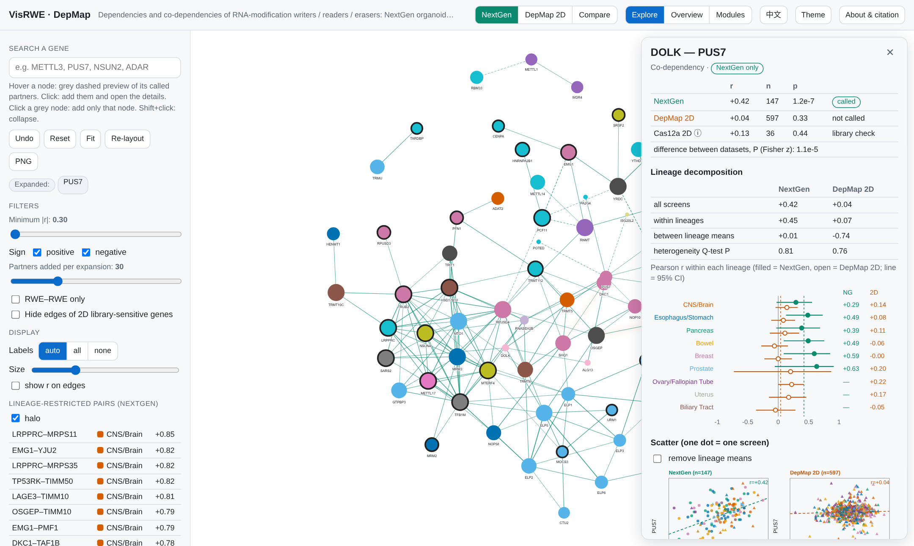

# VisRWE · DepMap

[English](README.md) · **中文**

RNA 修饰的 **writer / reader / eraser（RWE）** 基因在 DepMap NextGen 类器官 / 神经球 CRISPR 筛选中的依赖与共依赖，并与原始 DepMap 2D 筛选并排比较。

**交互页面 → <https://shuyang-zhao.github.io/VisRWE_DepMap/>**（单个静态网页，无需安装）



## 内容

* **217 个 RWE 基因**（m6A、Ψ、m5C、m7G、2′-O-甲基化、tRNA 修饰等），附角色、修饰、底物和解释警示。
* **单基因依赖**：NextGen（147 个筛选）与 DepMap 2D（同谱系 597 个筛选）中的依赖类别、效应大小、类器官 vs 2D、谱系选择性、生物标志物。
* **全部 5,693 个依赖基因的共依赖图谱**：两套数据用同一方法计算（各 1,620 万对），每个含 RWE 基因的显著对都标明"两边都显著 / 仅 NextGen / 仅 2D"。
* **交互页面**：从任意基因出发扩展网络——悬停预览伙伴，点击展开；点开任意一条边可看按谱系的分解（森林图、散点图，NextGen 与 2D 并列，并附 Cas12a 文库检查）；可在 NextGen、DepMap 2D、对比三种视图间切换，也可以用热图看功能模块富集；中英文界面。

目标很实际：做 RNA 修饰酶的人可以直接查到某个基因在两套数据中的依赖和共依赖伙伴，不需要自己处理 DepMap。

## 统计口径（与 NextGen 原文对齐）

完全按原文公开代码（[broadinstitute/DepMap-NextGen-Public](https://github.com/broadinstitute/DepMap-NextGen-Public)）：筛选级 Chronos gene effect；NextGen 与 2D 的筛选集合按原文定义；基因依赖类别用原文规则（重新实现后与原文 100% 一致，再用于 2D）；相关用两两完整的筛选计算 Pearson r；每个结果表做一次 Benjamini–Hochberg 校正；**FDR < 0.005 且 |r| > 0.3** 记为显著共依赖。另外用原始矩阵重算了原文发布的 expression-addiction 表，以验证数据处理一致。详见 [docs/methods.md](docs/methods.md)。

## 主要发现

* 约三分之一的 RWE 基因在两套数据中都是泛必需（writer 辅因子 57%，eraser 0%），NextGen 与 2D 的类别高度一致。
* RWE 基因的已知伙伴（从基因表复合物注释中提取的 138 对，覆盖全部修饰家族）在 NextGen 中显著的只有 14%，2D 中 40%；把 2D 降采样到 147 个筛选后仍有 35%，所以这是 NextGen 数据本身的特点，不是样本量或统计方法造成的；这种减弱出现在多数修饰家族，不是某一类机器特有（[报告第 4 节](docs/report.zh-CN.md)）。
* 每个 RWE 基因前 100 个伙伴中过表达的模块（16 个粗分类 + 1,439 个 Reactome / CORUM 模块，对所有基因用同一检验）主要指向这些基因自身所在的机器：线粒体翻译、tRNA 加工 / 修饰、rRNA 修饰。
* 35 对关联只在 NextGen 的单一谱系中极强（33 对在 CNS）。

完整报告：[docs/report.zh-CN.md](docs/report.zh-CN.md) · 图：[results/figures](results/figures) · 表：[results/tables](results/tables)（[数据字典](docs/data_dictionary.md)）· 工作簿：[results/VisRWE_DepMap_tables.xlsx](results/VisRWE_DepMap_tables.xlsx)

## 目录结构

```
├── data/
│   ├── curated/          RWE 基因表、对照基因、文献主张审计（随仓库提供）
│   ├── raw/              DepMap / figshare / 基因集下载（不纳入版本库，见 data/README.md）
│   └── raw.md5           原始输入的校验和
├── src/rwe_nextgen/      数据读取（原文口径）、统计、依赖分类
├── pipeline/             按编号运行的分析步骤 01–12
├── web/                  交互页面源码（HTML 模板、CSS、JavaScript、双语词典、vis-network）
├── docs/                 GitHub Pages 页面（index.html）及方法、报告、数据字典
└── results/              表格、图、工作簿（results/intermediate/ 由管线重新生成）
```

## 复现

```bash
conda env create -f environment.yml && conda activate visrwe
# 按 data/README.md 下载输入文件到 data/raw/，然后
make check      # 校验文件
make all        # 分析 → 交互页面 → 图 → 报告（约 10 分钟，约 4 GB 内存）
```

## 引用

使用本资源请引用（见 [CITATION.cff](CITATION.cff)）：

> Zhao S. *VisRWE: dependencies and co-dependencies of RNA-modification writers, readers and erasers in DepMap NextGen organoid and DepMap 2D
> CRISPR screens.* GitHub, 2026. <https://github.com/shuyang-zhao/VisRWE_DepMap>

并引用所用数据：

* Neiswender, Maffa, Brenan *et al.* A dependency map enhanced with next-generation 3D cancer models. *Nature* (2026). doi:10.1038/s41586-026-10843-7
* Tsherniak A. *et al.* Defining a cancer dependency map. *Cell* 170, 564–576 (2017).
* Dempster J. M. *et al.* Chronos: a cell population dynamics model of CRISPR experiments that improves inference of gene fitness effects. *Genome Biology* 22, 343 (2021).
* DepMap 门户（Broad Institute）<https://depmap.org>，文件集 "NextGen Model Manuscript 2026"。

## 作者

**Shuyang Zhao** — Department of Chemistry, University of California, Riverside.

## 许可

代码：MIT（见 [LICENSE](LICENSE)）。DepMap 数据由 Broad Institute 以 CC BY 4.0 发布，本仓库的表格和页面中内嵌的量化效应向量是其派生数据。基因集保留各自来源的许可。页面内置的 vis-network 为 Apache-2.0 / MIT 双许可。
