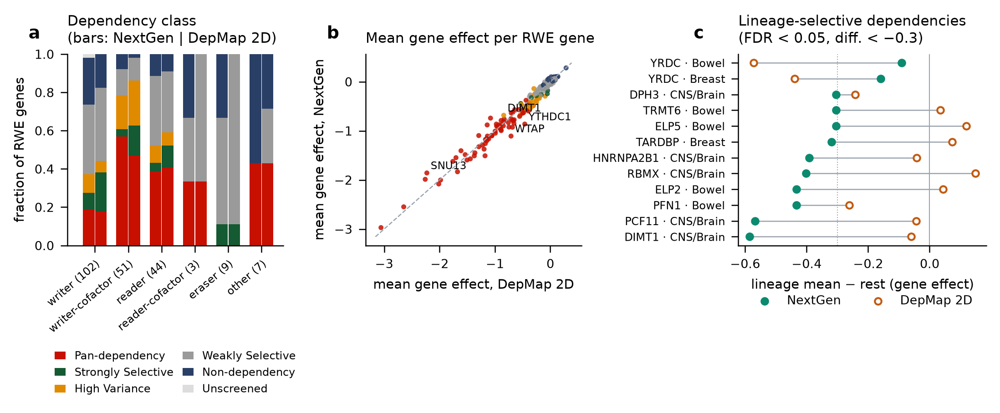
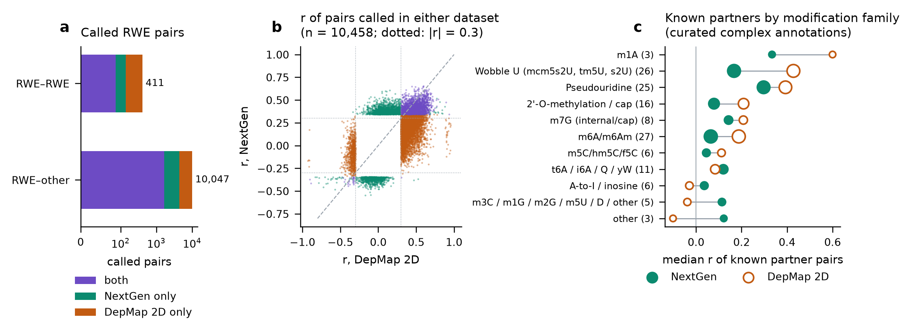
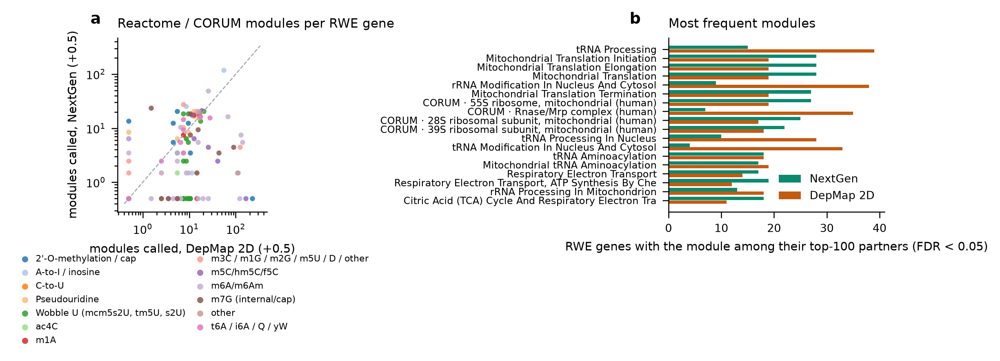

# RNA 修饰 writer / reader / eraser（RWE）在 DepMap NextGen 中的依赖与共依赖

**v3（统计口径对齐原文）** · 作者：Shuyang Zhao（Department of Chemistry, University of California, Riverside）· 生成日期 2026-10-09
交互页面：<https://shuyang-zhao.github.io/VisRWE_DepMap/> · 代码：<https://github.com/shuyang-zhao/VisRWE_DepMap>

> 数据：Neiswender, Maffa, Brenan *et al.* *A dependency map enhanced with next-generation 3D cancer models*. Nature (2026), doi:10.1038/s41586-026-10843-7；DepMap 门户文件集 "NextGen Model Manuscript 2026"。
> 本资源对所有修饰机器一视同仁：基因表、模块、已知伙伴、文库检查都用同一套规则，不为任何单个基因或假设设置专门的检验。

## 0. 要点

1. **统计口径与原文一致，并已验证**：用原始矩阵重算原文发布的 expression-addiction 表（17,889 个基因，|Δr| 在舍入精度内，n 完全相同）；重新实现的依赖分类与原文 100.00% 一致，再用同一规则给 2D 分类。
2. **单基因**：216 个 RWE 基因中 69 个是 NextGen 泛必需（32%，全基因组 8.7%，OR 5.0）；writer 辅因子 57%、reader 39%、writer 19%、eraser 0%。NextGen 与 2D 的类别高度一致；按原文口径，类器官 vs 贴壁 2D 只有 DIMT1（+0.32）、YTHDC1（-0.43） 显著；谱系选择性依赖 NextGen 10 个、2D 2 个。
3. **共依赖**（依赖基因两两 Pearson，每个数据集整表 BH，FDR < 0.005 且 |r| > 0.3）：NextGen 66,031 对、DepMap 2D 77,398 对（各 16,202,278 对检验）。含 RWE 基因的显著对 10,458 个：**两边都显著 1,752，仅 NextGen 2,738，仅 2D 5,968**；RWE–RWE 为 88 / 51 / 272。
4. **已知伙伴在 NextGen 中普遍变弱，多数修饰家族都如此**：从基因表复合物注释中提取的 138 对已知伙伴，2D 中显著 40%，NextGen 中只有 14%；在 2D 中共依赖（r ≥ 0.3）的 55 对，中位 r 从 0.49 降到 0.30，而 2D 降采样到 147 个筛选后仍有 82% 能检出——所以不是样本量或统计方法的问题。
5. **功能模块**（原文的排序超几何口径：每个 RWE 基因前 100 个正相关伙伴，对 16 个粗分类和 1,439 个 Reactome / CORUM 模块一视同仁地检验）：细模块显著 NextGen 880、2D 2,254 个（基因 × 模块）；最常见的是线粒体翻译、tRNA 加工 / 修饰、rRNA 修饰——即这些 RWE 基因自身所在的机器。
6. **谱系**："只在单一谱系极强"的共依赖 35 对（CNS/Brain 33, Bowel 2），其中 27 对在其余谱系 r ≤ 0.3。
7. **交互页面**（GitHub Pages）：NextGen / DepMap 2D / 对比三种数据视图；悬停预览、点击展开的探索网络；每条边按谱系分解（两套数据并列）并附 Cas12a 2D 文库检查；两级模块热图；中英文切换。

## 1. 数据与统计口径

| 项目 | 做法（与原文代码一致） |
|---|---|
| 依赖矩阵 | 筛选级 Chronos gene effect（`screen_gene_effect.csv`），缺失值不填补，相关用两两完整的筛选 |
| NextGen | ScreenType ∈ {2DO, 3DO, 3DN, 2DN}、IsNextGen、谱系 ≠ Other：**147 个筛选**（全部 Cas12a Humagne-CD 文库） |
| DepMap 2D | NextGen 谱系的传统 2D 筛选（原文 `adherent_next_gen_lineage_matched_screens`）：**597 个筛选**（Avana / KY 为主，另有 11 个 Humagne） |
| 文库检查 | 全部 36 个用 Cas12a（Humagne-CD）文库筛选的传统 2D 细胞系 |
| 依赖类别 | 原文 TDA 分类；2D 用同一规则重算 |
| 共依赖 | 依赖基因（任一数据集中为 Pan-dependency / Strongly Selective / High Variance，5,693 个）两两 Pearson；每个数据集一次 BH；FDR < 0.005 且 \|r\| > 0.3。NextGen 的 FDR 边界对应 p ≈ 2.1e-05，2D 为 3.0e-04 |
| 模块 | 16 个粗分类（正则表达式，所有基因同一规则）+ Reactome 2022 / CORUM 中在依赖基因里有 5–150 个成员的全部模块；每个 RWE 基因前 100 个正相关伙伴做单侧超几何检验（原文 `run_rank_hypergeometric`），每个数据集、每个层级一次 BH，FDR < 0.05 |
| 组间比较 | 类器官 vs 贴壁 2D：原文表；谱系 vs 其余：Mann–Whitney，FDR < 0.05 且差值 < −0.3 |

**文库**：24 个两种文库都筛过的模型里，只有 NCBP2 的 Cas12a − Cas9 差异显著且 > 0.3；2D 内部 KY vs Avana 差异大的 RWE 基因（R² ≥ 0.1）有 SNU13, OSGEP, NFS1，它们的 2D 边和模块在页面中有标记。

## 2. 单基因依赖



**谱系选择性依赖**（谱系 vs 其余，FDR < 0.05 且差值 < −0.3）：

| 基因 | 谱系 | NextGen 差值 | NextGen FDR | 2D 差值 | 2D FDR | 类别 |
|---|---|---|---|---|---|---|
| YRDC | Breast | -0.159 | 0.445 | -0.44 | 0.0102 | DepMap 2D only |
| YRDC | Bowel | -0.0913 | 0.521 | -0.573 | 0.00119 | DepMap 2D only |
| DIMT1 | CNS/Brain | -0.585 | 5.8e-07 | -0.06 | 0.102 | NextGen only |
| PCF11 | CNS/Brain | -0.568 | 2.05e-07 | -0.0434 | 0.33 | NextGen only |
| PFN1 | Bowel | -0.434 | 0.000591 | -0.261 | 0.00252 | NextGen only |
| ELP2 | Bowel | -0.433 | 0.0179 | 0.0439 | 0.311 | NextGen only |
| RBMX | CNS/Brain | -0.402 | 0.0179 | 0.148 | 0.0102 | NextGen only |
| HNRNPA2B1 | CNS/Brain | -0.392 | 1.77e-05 | -0.0418 | 0.607 | NextGen only |
| TARDBP | Breast | -0.319 | 0.0161 | 0.073 | 0.534 | NextGen only |
| ELP5 | Bowel | -0.304 | 0.00553 | 0.119 | 0.195 | NextGen only |
| TRMT6 | Bowel | -0.304 | 0.0274 | 0.035 | 0.577 | NextGen only |
| DPH3 | CNS/Brain | -0.304 | 0.00013 | -0.243 | 4.89e-09 | NextGen only |

**类器官 vs 贴壁 2D**（原文表）：按原文口径（排除两组都必需的基因）只有 DIMT1 +0.32、YTHDC1 -0.43；不排除时差值 > 0.3 的还有 WTAP -0.48、RNMT -0.45、YBX1 +0.30、RBMX +0.34、SNU13 +0.41、PCF11 +0.49。**生物标志物**（原文表与阈值）：表达成瘾 0 个；旁系 2 个（PFN1–PFN2 r = 0.51, SRSF2–SRSF12 r = 0.31）。

## 3. 共依赖：NextGen vs DepMap 2D



126 个进入检验的 RWE 基因中，120 个在 NextGen、101 个在 2D 至少有一个显著伙伴。伙伴最多的是线粒体 RNA 加工 / 翻译相关的 RWE：

| 基因 | NextGen | DepMap 2D | 两边都显著 |
|---|---|---|---|
| RPUSD4 | 232 | 297 | 154 |
| TFB1M | 226 | 307 | 155 |
| TRUB2 | 202 | 305 | 178 |
| HSD17B10 | 195 | 325 | 154 |
| LRPPRC | 185 | 295 | 161 |
| YRDC | 182 | 56 | 7 |
| PCF11 | 175 | 2 | 1 |
| MRM3 | 163 | 297 | 132 |
| MTO1 | 158 | 254 | 100 |
| MTERF4 | 146 | 289 | 104 |

## 4. 已知伙伴（全部修饰家族，同一规则）

已知伙伴取自基因表中每个 RWE 基因的复合物注释里点名、且属于依赖基因的伙伴，共 138 对。

| 修饰家族 | 已知伙伴对 | NextGen 中位 r | 2D 中位 r | NextGen 显著比例 | 2D 显著比例 | 2D 降采样到 147 的显著比例 |
|---|---|---|---|---|---|---|
| 2'-O-methylation / cap | 16 | 0.08 | 0.21 | 0.06 | 0.19 | 0.13 |
| A-to-I / inosine | 6 | 0.04 | -0.03 | 0.00 | 0.17 | 0.17 |
| C-to-U | 1 | -0.14 | -0.12 | 0.00 | 0.00 | 0.00 |
| Pseudouridine | 25 | 0.30 | 0.39 | 0.28 | 0.68 | 0.59 |
| Wobble U (mcm5s2U, tm5U, s2U) | 26 | 0.17 | 0.43 | 0.23 | 0.58 | 0.56 |
| ac4C | 1 | 0.17 | 0.03 | 0.00 | 0.00 | 0.00 |
| m1A | 3 | 0.33 | 0.60 | 0.33 | 1.00 | 0.99 |
| m3C / m1G / m2G / m5U / D / other | 5 | 0.11 | -0.04 | 0.00 | 0.20 | 0.22 |
| m5C/hm5C/f5C | 6 | 0.05 | 0.11 | 0.17 | 0.33 | 0.27 |
| m6A/m6Am | 27 | 0.06 | 0.19 | 0.00 | 0.26 | 0.19 |
| m7G (internal/cap) | 8 | 0.14 | 0.21 | 0.12 | 0.12 | 0.17 |
| other | 3 | 0.12 | -0.10 | 0.33 | 0.33 | 0.12 |
| t6A / i6A / Q / yW | 11 | 0.12 | 0.08 | 0.18 | 0.36 | 0.28 |
| all families | 138 | 0.14 | 0.24 | 0.14 | 0.40 | 0.35 |

读法：① 2D 降采样到与 NextGen 相同的 147 个筛选后，显著比例几乎不变（40% → 35%），而 NextGen 只有 14%，所以**样本量和统计方法都不是原因**；② 在已知伙伴 ≥ 8 对的 6 个修饰家族中，5 个在 NextGen 中显著比例更低（2'-O-methylation / cap、Pseudouridine、Wobble U (mcm5s2U, tm5U, s2U)、m6A/m6Am、t6A / i6A / Q / yW），不是某一类机器特有；③ 扣除筛选级"必需性轴"后 NextGen 的 r 变化不大（`known_partners.tsv` 中的 `r_NextGen_axis_adjusted`）。可能的解释包括 3D 培养下这些基因的依赖受其他因素驱动，以及 Cas12a 文库的向导差异，现有数据无法区分。

以 m6A writer 为例（回答"METTL3 / YTH 为什么找不到自己的伙伴"）：METTL3–METTL14 在 2D 中 r = +0.54（降采样后 100% 被检出），NextGen 中只有 +0.32；m6A 家族 27 对已知伙伴的中位 r 为 NextGen 0.06 vs 2D 0.19。YTHDF1/YTHDF3/YTHDC2 在两套数据中都不是依赖基因，不进入共依赖检验。

## 5. 功能模块



粗分类（基因 × 类别）：两边都显著 83、仅 NextGen 42、仅 2D 91。Reactome / CORUM 细模块：两边都显著 299、仅 NextGen 581、仅 2D 1955；其中 328 个在 Cas12a 2D 中也显著，"仅 NextGen"的细模块里有 18% 在 Cas12a 2D 中也显著（文库可能参与）。被最多 RWE 基因富集的模块：

| 模块 | NextGen 中富集的 RWE 基因数 | 2D | Cas12a 2D |
|---|---|---|---|
| Reactome: tRNA Processing | 15 | 39 | 11 |
| Reactome: Mitochondrial Translation | 28 | 19 | 14 |
| Reactome: Mitochondrial Translation Elongation | 28 | 19 | 14 |
| Reactome: Mitochondrial Translation Initiation | 28 | 19 | 14 |
| Reactome: rRNA Modification In Nucleus And Cytosol | 9 | 38 | 7 |
| CORUM: 55S ribosome, mitochondrial (human) | 27 | 19 | 14 |
| Reactome: Mitochondrial Translation Termination | 27 | 19 | 14 |
| CORUM: 28S ribosomal subunit, mitochondrial (human) | 25 | 17 | 13 |
| CORUM: Rnase/Mrp complex (human) | 7 | 35 | 2 |
| CORUM: 39S ribosomal subunit, mitochondrial (human) | 22 | 18 | 14 |
| Reactome: tRNA Processing In Nucleus | 10 | 28 | 0 |
| Reactome: tRNA Modification In Nucleus And Cytosol | 4 | 33 | 6 |

## 6. 案例

以下案例读取的都是上面的通用结果，没有专门的检验。

**PUS7**：NextGen 中 10 个显著伙伴，2D 中没有：

| 伙伴 | NextGen r | NextGen FDR | DepMap 2D r |
|---|---|---|---|
| ALG13 | 0.426 | 8.86e-05 | 0.0471 |
| DOLK | 0.417 | 0.000147 | 0.0431 |
| RNASEH2B | 0.388 | 0.000691 | 0.0831 |
| POTED | -0.38 | 0.00102 | -0.0523 |
| PA2G4 | 0.366 | 0.00197 | -0.13 |
| ISG20L2 | -0.358 | 0.00276 | 0.0371 |
| MTA2 | 0.354 | 0.00329 | -0.0142 |
| DNAJC21 | 0.345 | 0.00468 | -0.0797 |
| PSME3 | 0.344 | 0.00489 | 0.0274 |
| FERMT1 | 0.344 | 0.00493 | 0.0868 |

PUS7–DOLK：NextGen +0.42，2D +0.04，两数据集差异 P = 2e-05。在统一的模块检验中，PUS7 的前 100 个伙伴与 N-糖基化相关 Reactome 通路的重叠很小，校正后不显著：

| Reactome 通路 | 成员数 | NextGen 重叠（/100） | NextGen FDR | 2D 重叠 | Cas12a 2D 重叠 |
|---|---|---|---|---|---|
| Reactome: Biosynthesis Of N-glycan Precursor (Dolichol LLO) And Transfer To Protein | 39 | 3 | 1 | 0 | 1 |
| Reactome: N-glycan Trimming In ER And Calnexin/Calreticulin Cycle | 20 | 0 | 1 | 0 | 0 |
| Reactome: Synthesis Of Dolichyl-phosphate | 6 | 1 | 1 | 0 | 0 |
| Reactome: Synthesis Of Substrates In N-glycan Biosythesis | 28 | 2 | 1 | 0 | 0 |

v2 曾用一个预先指定的"早期 DLO + 多萜醇供应"模块单独检验 PUS7 并得到显著结果；那是针对单一假设的检验，在对所有基因、所有模块一视同仁的框架下不再突出。另外同一信号在 36 个 Cas12a 2D 细胞系中也能看到（v2），所以即使存在，也可能与文库有关。

**DKC1**：2D 301 个显著伙伴，NextGen 40 个（22 个共有）；模块层面两边都指向 rRNA 修饰 / 核糖体生物发生。**TRUB1**：两套数据中都不是依赖基因。**WTAP、YTHDC1**：NextGen 中伙伴多为 TAF12、POLR2G、CCDC174 等通用必需基因。

## 7. 谱系分解与"只在单一谱系极强"的关联

发现仍在合并数据上做；页面中每条边都能按谱系分解（森林图 + 散点，NextGen 与 2D 并列）。另外在 NextGen 的 5 个 ≥ 14 个筛选的谱系内检验含 RWE 基因的对（谱系内 Pearson，所有"对 × 谱系"一次 BH，FDR < 0.005 且 \|r\| > 0.3，且与其余谱系的 Fisher-z 差异 P < 0.01）：共 35 对（单谱系限定 27、明显更强 7、各谱系都有而此谱系更强 1）。前 20 对：

| A | B | 谱系 | n | 谱系内 r | FDR | 其余谱系 r | 类型 |
|---|---|---|---|---|---|---|---|
| LRPPRC | MRPS11 | CNS/Brain | 39 | 0.848 | 3.5e-05 | 0.401 | enriched |
| EMG1 | YJU2 | CNS/Brain | 39 | 0.823 | 0.000222 | -0.205 | restricted |
| LRPPRC | MRPS35 | CNS/Brain | 39 | 0.819 | 0.000222 | 0.528 | shared, stronger here |
| TP53RK | TIMM50 | CNS/Brain | 39 | 0.816 | 0.000223 | 0.388 | enriched |
| LAGE3 | TIMM10 | CNS/Brain | 39 | 0.808 | 0.000348 | 0.237 | restricted |
| OSGEP | TIMM10 | CNS/Brain | 39 | 0.792 | 0.00114 | 0.167 | restricted |
| EMG1 | PMF1 | CNS/Brain | 39 | 0.786 | 0.00152 | 0.0469 | restricted |
| DKC1 | TAF1B | CNS/Brain | 39 | 0.784 | 0.00161 | 0.17 | restricted |
| GAR1 | MRPL41 | CNS/Brain | 39 | 0.779 | 0.00187 | 0.0137 | restricted |
| NOP56 | NLE1 | CNS/Brain | 39 | 0.779 | 0.00187 | 0.322 | enriched |
| PCF11 | FARSB | CNS/Brain | 39 | -0.776 | 0.00213 | -0.0216 | restricted |
| NAF1 | NOPCHAP1 | CNS/Brain | 39 | 0.773 | 0.00239 | 0.149 | restricted |
| MYBBP1A | ATP5PD | CNS/Brain | 39 | 0.77 | 0.0026 | -0.0559 | restricted |
| TRMT6 | RBBP4 | CNS/Brain | 39 | 0.769 | 0.0026 | 0.318 | enriched |
| TRMT10C | MRPL57 | CNS/Brain | 39 | 0.768 | 0.0026 | 0.322 | enriched |
| OSGEP | TP53RK | CNS/Brain | 39 | 0.762 | 0.00388 | 0.215 | restricted |
| CENPA | NUTF2 | CNS/Brain | 39 | -0.761 | 0.00392 | 0.0736 | restricted |
| DKC1 | SHQ1 | CNS/Brain | 39 | 0.759 | 0.00399 | 0.11 | restricted |
| TP53RK | TPRKB | CNS/Brain | 39 | 0.758 | 0.00399 | 0.279 | restricted |
| TRMT5 | RFT1 | CNS/Brain | 39 | 0.758 | 0.00399 | 0.344 | enriched |

2D 不做这一步：2D 各谱系混有比例不同的 Avana / KY / Humagne 筛选，谱系内相关会被文库组成混杂。

## 8. 文献主张

86 条逐条核实的主张：partially supported 27, not testable in NextGen (lineage absent) 14, supported 14, not testable by viability screen 14, not supported 14, contradicted 3。基因层面最常见的是"有依赖主张、数据中泛必需（选择性不成立）"23 个，"主张未复现"26 个，"没有主张但泛必需"33 个。

## 9. 局限

1. NextGen 只有 Cas12a 文库，2D 以 Cas9 为主；"仅 NextGen"的信号应先看页面中的 Cas12a 2D 文库检查。
2. 原文口径不调整谱系、筛选质量；一部分共依赖来自谱系组成或通用必需机器（线粒体翻译、核糖体），页面的谱系分解用来判断这一点。
3. 共依赖不等于相互作用；许多 RWE 的依赖来自催化非依赖的结构功能（基因表中 `caveat_class`）。
4. 非依赖基因不进入共依赖检验，"没有伙伴"不等于"没有关系"。
5. 模块的超几何检验不考虑模块内部基因的相关，和原文一样；它回答"前 100 个伙伴里是否过表达"，不是"整体相关是否更强"。
6. 谱系内检验样本量小（14–39），只看极强的关联。

## 10. 复现与文件

```bash
conda env create -f environment.yml && conda activate visrwe
make all
```

| 文件 | 内容 |
|---|---|
| `results/tables/single_gene_rwe.tsv` | 每个 RWE 基因：类别、平均效应、依赖比例、类器官 vs 2D、谱系、文库、生物标志物 |
| `results/tables/codep_rwe_calls.tsv` | 含 RWE 基因、在任一数据集显著的共依赖对 |
| `results/tables/codep_summary_per_gene.tsv` | 每个 RWE 基因的显著伙伴数与最强伙伴 |
| `results/tables/known_partners.tsv`、`known_partners_by_family.tsv` | 已知伙伴检查（第 4 节） |
| `results/tables/module_enrichment_categories.tsv`、`module_enrichment_pathways.tsv` | 模块富集（第 5 节） |
| `results/tables/lineage_restricted_pairs.tsv` | 谱系限定的强关联 |
| `results/VisRWE_DepMap_tables.xlsx` | 以上表格汇总 |
| `docs/index.html` | 交互页面（GitHub Pages） |
